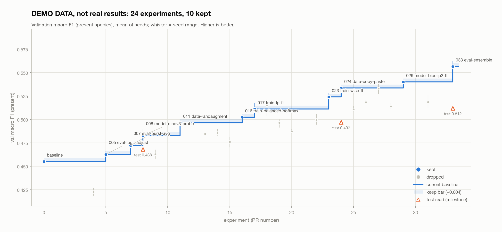

# 🧪 How we run experiments

1. **Start:** open a draft PR titled `category: name`, for example `data: randaugment`.
2. **The bot adds your report** `experiments/012-data-randaugment.md`. The number is the PR number, so it never clashes. Pull it, run your experiment, fill it in.
3. **Better than the baseline on all 3 seeds** (by more than seed noise): merge. It becomes the new baseline.
4. **Not better:** add the label `no-win`. The bot removes your code and keeps the report. Then merge.
5. **Validation only.** Test is read at milestones only, by one person.

**Categories:** `data` · `model` · `train` · `adapt` · `eval` · `other` (fits none).

**The bot** (GitHub Actions) does three things: a new PR gets its numbered report; the `no-win` label strips the code from the PR; every merge redraws the chart below.

## 📈 Progress

*Demo data until [`000-baseline.md`](000-baseline.md) has its scores.*
